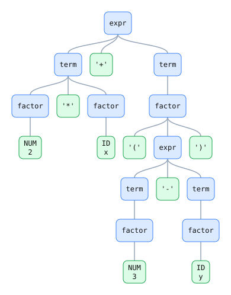

aluno: 2024.1905.029-8
aluno: 2024.1905.065-4
aluno: 2024.1905.022-0
uso_ia: sim

# Compiladores I - Trabalho Prático 2: Gerador de Analisadores Sintáticos

Este programa lê uma gramática escrita em EBNF e gera, em ANSI C, um analisador sintático descendente recursivo para a linguagem que ela descreve. O gerador não lê o programa do usuário. Quem lê o programa, token a token, é o analisador que ele gera.

Como extra, o analisador gerado também desenha a árvore de derivação, em texto (`--tree`) e em imagem SVG (`--svg`).

O fluxo completo é este:

```
gramatica.ebnf  ->  ./gerador  ->  parser.c + parser.h  ->  gcc  ->  analisador  ->  "entrada aceita"
                                                                          ^
                                                                programa do usuario
```

## Passo a passo

Todos os comandos abaixo são executados na raiz do projeto.

### Passo 1: preparar o ambiente

O trabalho foi feito para Linux. No Windows, use o WSL (Ubuntu). São necessárias quatro ferramentas:

```
sudo apt install build-essential flex valgrind
```

Para conferir, `gcc --version`, `make --version` e `flex --version` devem mostrar um número de versão.

### Passo 2: compilar o gerador

```
make
```

Isso cria o executável `./gerador` e também o analisador de Micro C em `build/microc/parser_microc`. A compilação usa `gcc -ansi -pedantic -Wall -Wextra` e não deve mostrar nenhum aviso. A única exceção é o `lex.yy.c` que o flex produz.

### Passo 3: rodar os testes

```
make test
```

No final deve aparecer `26 de 26 testes passaram`. Se algum falhar, o script indica um arquivo `.diff` em `build/testes/`: as linhas com `-` são o esperado e as com `+` são o que o programa produziu.

### Passo 4: gerar um analisador a partir de uma gramática

```
./gerador testes/gramaticas/expr.ebnf -o build/expr --tree
```

Isso grava `build/expr.c` e `build/expr.h`. A pasta `build/` precisa existir (o `make` já a cria). As opções do gerador são:

| Opção | O que faz |
| --- | --- |
| `-o prefixo` | Grava `prefixo.c` e `prefixo.h` |
| `--sets` | Imprime a tabela de anulável, FIRST e FOLLOW |
| `--debug` | Imprime a gramática como foi lida |
| `--tree` | Inclui no analisador o suporte à árvore (`--tree` e `--svg`) |
| `--scanner microc` | Usa o scanner do TP1 em vez de gerar um léxico |

Para ver os conjuntos de uma gramática sem gerar código:

```
./gerador testes/gramaticas/expr.ebnf --sets
```

### Passo 5: compilar o analisador gerado

```
gcc -ansi -pedantic -Wall -Wextra -o build/expr_bin build/expr.c
```

### Passo 6: executar o analisador

Crie um arquivo `exemplo.txt` com o texto `2 * x + (3 - y)` e rode:

```
./build/expr_bin exemplo.txt
```

A saída é `entrada aceita` e o código de saída é 0. Se houver erro, a mensagem mostra a posição e o que era esperado, e o código de saída é 1:

```
linha 1, coluna 10: encontrado ')', esperado um de {NUM, ID, '('}
linha 1, coluna 5: erro lexico: caractere invalido '@'
```

Sem argumento, o analisador lê da entrada padrão.

### Passo 7: ver a árvore de derivação no terminal

```
./build/expr_bin --tree exemplo.txt
```

Cada nível de recuo é uma chamada de procedimento e as folhas são os tokens consumidos:

```
expr
  term
    factor
      NUM '2'
    '*'
    factor
      ID 'x'
  '+'
  term
    factor
      '('
      expr
        term
          factor
            NUM '3'
        '-'
        term
          factor
            ID 'y'
      ')'
entrada aceita
```

### Passo 8: ver a árvore de derivação como imagem

```
./build/expr_bin --svg arvore.svg exemplo.txt
```

Abra o `arvore.svg` em qualquer navegador. Dá para usar `--tree` e `--svg` juntos. O arquivo só é gravado quando a entrada é aceita. Não terminais aparecem em azul e tokens em verde, e tokens com lexema variável (`NUM`, `ID`) mostram o lexema embaixo do nome.



Outro exemplo, do programa `testes/programas/microc/soma.mc`: [docs/arvore_microc_soma.svg](docs/arvore_microc_soma.svg).

Como funciona: as funções `arvore_entra` e `match`, que já imprimiam a árvore em texto, também guardam cada nó num vetor, em pré-ordem e com o índice do pai. No fim da análise, `svg_gravar` calcula as posições e escreve o arquivo. Cada subárvore guarda o limite esquerdo e o direito de cada nível. Os filhos são colocados da esquerda para a direita, o mais perto possível sem que dois nós do mesmo nível se toquem, e o pai fica centralizado entre o primeiro e o último filho. O código dessa parte está no vetor `rt_svg` de `src/codegen.c` e só entra no analisador quando a geração usa `--tree`.

### Passo 9: usar o scanner do TP1 (Micro C)

O Passo 2 já gerou o analisador de Micro C. Para rodá-lo:

```
./build/microc/parser_microc testes/programas/microc/soma.mc
./build/microc/parser_microc --tree --svg arvore.svg testes/programas/microc/soma.mc
./build/microc/parser_microc --tokens tokens.txt
```

A última forma lê o arquivo de tokens gravado pelo TP1 (uma linha por token, como `Token: tipo = 33, lexema = 'int', linha = 1`). A saída deve ser igual à da leitura direta do programa. Nesse modo as mensagens de erro não têm coluna, porque o scanner do TP1 só guarda a linha.

Para limpar tudo: `make clean`.

## Como o gerador funciona

O `main.c` executa cinco etapas e para na primeira que encontrar erros. Avisos não impedem a geração. Erros impedem, e nenhum arquivo é escrito.

| Etapa | Arquivo | O que faz |
| --- | --- | --- |
| 1. Leitura | `ebnf_lexer.c`, `ebnf_parser.c` | Analisador descendente recursivo da própria notação EBNF. Monta a árvore `Expr` de cada regra e se recupera de erros sincronizando no `;`. |
| 2. Verificação | `verificacao.c` | Não terminais indefinidos, terminais não declarados, inalcançáveis (aviso) e improdutivos (erro). Os dois últimos usam ponto fixo. |
| 3. Conjuntos | `conjuntos.c` | Anulável, FIRST e FOLLOW por iteração até nada mais mudar. São calculados para cada nó da árvore, não só para cada regra. |
| 3b. Recursão à esquerda | `verificacao.c` | Monta a relação "B pode começar a regra de A", inclusive através de prefixos anuláveis como `[ "," ] lista`, calcula o fecho transitivo e olha a diagonal. Detecta a recursão direta e a indireta. |
| 4. LL(1) | `ll1.c` | Confere as três condições: FIRST das alternativas disjuntos; alternativa anulável com FOLLOW disjunto dos FIRST das outras; conteúdo de `[ ]` e `{ }` não anulável. |
| 5. Geração | `codegen.c` | Escreve uma função `parse_X()` por não terminal, o léxico, as mensagens de erro e o suporte à árvore. |

Tradução das regras (`gen_expr`):

- terminal vira `match(T)`;
- não terminal vira `parse_X()`;
- sequência vira as traduções em ordem;
- alternativa vira `if / else if / else`, testando o FIRST de cada ramo. O ramo anulável vai no `else`. Se nenhum ramo for anulável, o `else` reporta o erro;
- `[ a ]` vira `if` com o FIRST de `a`;
- `{ a }` vira `while` com o FIRST de `a`.

Conjuntos com mais de três tokens viram constantes `conj_N`, testadas pela função `pertence()`.

Léxico próprio (`gen_casamento_regex`): cada expressão regular de TOKENS vira um AFN (construção de Thompson), depois um AFD (construção de subconjuntos), e é escrita como um `switch` em C que reconhece o maior prefixo possível. São aceitos `|`, `*`, `+`, `?`, grupos `( )`, classes `[a-z]` e `[^...]`, o ponto e escapes. Quando um literal e um terminal com regex casam o mesmo tamanho, o literal vence. É assim que `"while"` ganha de `ID`.

Else pendente: em `[ "else" comando ]`, o FIRST e o FOLLOW se cruzam em `else`. Isso gera um aviso e é resolvido de forma gulosa: o analisador entra no `[ ]` sempre que o token está no FIRST. Assim o `else` fica com o `if` mais próximo, como em C.

### Mensagens do gerador

| Situação | Mensagem |
| --- | --- |
| Falta o `;` | `a.ebnf:5:7: erro: esperado ';', encontrado '='` |
| Não terminal sem regra | `b.ebnf:4:21: erro: nao terminal item usado mas nao definido` |
| Terminal fora de TOKENS | `c.ebnf:4:21: erro: terminal ID nao declarado em TOKENS` |
| Regra que nunca é usada | `f.ebnf:6:3: aviso: nao terminal sobra inalcancavel a partir de lista` |
| Repetição que pode não consumir nada | `erro: conflito LL(1) em lista: o conteudo de { } e anulavel` |

## Estrutura do código

```
src/
  main.c           ordem das etapas e opções de linha de comando
  util.c           alocação e mensagens de erro (arquivo:linha:coluna)
  bitset.c         conjuntos de terminais (FIRST e FOLLOW)
  gramatica.c      gramática em memória, árvore Expr e impressão em EBNF
  ebnf_lexer.c     léxico da notação EBNF
  ebnf_parser.c    leitura das seções TOKENS e RULES e das expressões
  verificacao.c    verificações semânticas e recursão à esquerda
  conjuntos.c      anulável, FIRST e FOLLOW
  ll1.c            condições LL(1)
  codegen.c        geração do .c e do .h (inclui o léxico por AFD e a árvore SVG)
  microc_mapa.c    literais da gramática e TokenType do tokens.h do TP1
microc/            scanner do TP1 e adaptador (scanner.c)
testes/            gramáticas, programas, saídas esperadas e executar.sh
docs/              exemplos de árvore em SVG
relatorio/         relatório em PDF (relatorio.pdf) e o HTML que o gera
```

Para ler o código, comece por `src/gramatica.h`, que descreve a árvore `Expr` usada em todas as etapas.

## Micro C e o scanner do TP1

Quando a gramática declara `TOKENS EXTERN "tokens.h" ;` e o gerador roda com `--scanner microc`, o analisador gerado não tem léxico próprio. Ele chama `proximo_token()`, que usa o scanner do TP1, e os terminais da gramática são os nomes de `TokenType`.

A gramática `testes/gramaticas/microc.ebnf` é a do Apêndice B do livro-texto, fatorada para ser LL(1). `atribuicao_interna` e `fator` tinham alternativas iniciadas por `ID`, e o opcional `[ "[" expressao "]" ]` substitui as duas.

### Correções feitas no TP1

Os trechos alterados estão marcados com `TP2 ALTERADO` em `microc/microc.flex` e `microc/scanner.c`:

- foram acrescentados o prefixo `microc_yy` e `%option noyywrap`, e a função `yywrap()` foi removida;
- `TokenType`, `Token` e `YYSTYPE` foram para o `tokens.h`, e a regra `<<EOF>>` devolve `END_OF_FILE`;
- "String nao terminada" passou a ser reportada na linha da própria string, usando `yyless(0)` para devolver a quebra de linha (antes aparecia na linha seguinte);
- o `main()` de teste do TP1 só é compilado com `-DMICROC_LEXER_MAIN`;
- `microc_tabela_liberar()` libera a tabela de strings, para não haver vazamento;
- no adaptador `scanner.c`, o lexema de `ID` e das constantes vem da tabela de strings (com os escapes já convertidos), o token `UNDEF` traz a mensagem de erro do scanner e os tokens devolvidos pelo código ASCII são convertidos para `TokenType`. Valores até `PRINT` são sempre `TokenType`, então o `!` é devolvido como `NOT`.

## Testes

O `make test` compara a saída do gerador (`testes/esperado/*.gerador`) e a dos analisadores gerados (`testes/programas/<gramática>/*.esperado`) com as saídas esperadas. Cada caso termina com a linha `status <código de saída>`.

| Gramática | Tipo | Programas |
| --- | --- | --- |
| `expr.ebnf` | válida, expressões aritméticas | 3 aceitos e 4 rejeitados |
| `json.ebnf` | válida, JSON simplificado | 3 aceitos e 3 rejeitados |
| `microc.ebnf` | válida, Micro C com o scanner do TP1 | 3 aceitos e 3 rejeitados |
| `recursao_esquerda.ebnf` | recusada, recursão à esquerda direta e indireta | nenhum |
| `conflito_ll1.ebnf` | recusada, conflito LL(1) | nenhum |

A pasta `testes/arvore/` confere a árvore em texto e a em SVG de `2 * x + (3 - y)`. Os programas de Micro C só rodam depois do `make microc` (o `make` comum já faz isso).

Para criar um caso novo, coloque o programa em `testes/programas/<gramática>/`, rode o analisador, confira a saída à mão e salve em um arquivo `.esperado` com o mesmo nome, terminando com a linha `status 0` ou `status 1`.

Também rodamos `valgrind --leak-check=full` no gerador (com todas as gramáticas) e nos analisadores gerados (com todos os programas de teste, usando `--tree` e `--svg`). Não houve vazamento nem acesso inválido.

## Uso de IA

Usamos o Claude Code (Claude Sonnet 5.5) em duas fases. Durante a implementação, como tutor para tirar dúvidas de conceito e de C sobre o código fornecido, sem copiar nenhum trecho dos `TODO(aluno)` de uma resposta da IA. Na fase final, para escrever a árvore em SVG, a gramática JSON, os testes novos, o README e o relatório. O registro completo, entrada por entrada, está em [USO_IA.md](USO_IA.md).
